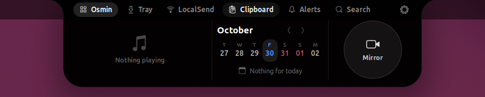

<h1 align="center">Osmin</h1>

<p align="center">
  A Dynamic Island for the GNOME desktop: one small capsule at the top of the screen that shows
  what is going on and opens into a panel with music, calendar, clipboard, file shelf and more.
</p>

<p align="center">
  
  
  
</p>

<p align="center">
  <br>
  
</p>

## What is it?

Osmin is a **GNOME Shell extension** that replaces the clock in the middle of the top bar with a
capsule, in the spirit of the iPhone's Dynamic Island.

- **Closed**, it is small and shows the time, or what is happening right now: a timer, the music
  that is playing, a meeting that starts soon, a file that is downloading.
- **Opened** (hover, click or a shortcut), the same capsule grows into a panel with widgets and tabs.

It runs entirely in your user session: no root, no system files are touched, and turning the
extension off brings the stock GNOME clock back.

## What can it do?

| Area | What you get |
|---|---|
| **Now playing** | Any media player (MPRIS): cover art, title, controls, a progress line; optional synced lyrics |
| **Calendar** | A strip of days and the events from your GNOME calendars; a bigger month view |
| **Clipboard** | History of what you copied, pinned items, quick notes, drag an item into any app |
| **File tray** | Drop files on the top of the screen to park them; drag them out later |
| **LocalSend** | Send files to phones and computers running [LocalSend](https://localsend.org), or receive them |
| **Search bar** | Launch apps, calculate, convert units, `kill` a process, see open `ports`, text snippets |
| **Quick toggles** | Keep awake, dark mode, night light, lock, screenshot, screen recording, colour picker, brightness |
| **Focus** | Pomodoro timer and stopwatch that live in the capsule |
| **System** | CPU, memory, temperature, network, disk, battery, with alerts |
| **Sound** | Volume, output, microphone and per-application volume |
| **Windows** | Live window previews and snap buttons (halves, maximize, next monitor) |
| **Downloads** | Progress, size and speed of what lands in your Downloads folder |
| **Mirror** | A round webcam preview, the camera is on only while you look |
| **AI agents** | Claude Code / Codex: what is working now and token use (read from local logs) |
| **Alerts** | The notifications GNOME holds, with Do Not Disturb |
| **Settings** | A modern settings window: turn widgets on or off, reorder them, change look and gestures |

Everything is optional: pick the widgets you want in the settings.

## Requirements

- **GNOME Shell 50** (for example Ubuntu 26.04) on a **Wayland** session
- `gjs` and `glib-compile-schemas`
  (Ubuntu / Debian: `sudo apt install gjs libglib2.0-bin`, Fedora: `sudo dnf install gjs glib2`)
- Normally already installed: GStreamer with PipeWire / V4L2 plugins (for Mirror) and `openssl` (for LocalSend)

## Installation

### From a release (recommended)

1. Download `Osmin-<version>.zip` from the [Releases](https://github.com/bekov0004/Osmin/releases) page.
2. Install it:
   ```bash
   gnome-extensions install --force Osmin-<version>.zip
   ```
3. **Log out and log in again.** Wayland cannot load a new extension into a running session.
4. Enable it:
   ```bash
   gnome-extensions enable osmin@osmin.dev
   ```

### From source

```bash
git clone https://github.com/bekov0004/Osmin.git
cd Osmin
scripts/install.sh
```

Then log out and in, and enable it as in step 4 above.

### Try it without logging out

If `mutter-devkit` is installed, `scripts/install.sh --nested` opens a separate nested GNOME
Shell with Osmin enabled, so nothing changes in your real session.

### Update

Download the new zip (or `git pull`), run the same install command, log out and in again.

### Uninstall

```bash
scripts/uninstall.sh                        # removes the extension and the app launcher
rm -r ~/.local/share/osmin ~/.cache/osmin   # optional: also your notes, tray, history and caches
```

Without the clone: `gnome-extensions uninstall osmin@osmin.dev`.

## Using Osmin

**Open and close.** Move the pointer to the capsule and rest it there, or click it. Click outside,
press `Esc` or press the shortcut again to close.

**Tabs.** The header of the panel has the tabs. Each one has a different job:

| Tab | Use it for |
|---|---|
| **Osmin** | The widgets: music, calendar, mirror and the ones you added |
| **Tray** | A shelf for files. Drag a file to the top of the screen, release it on the capsule. Files are only referenced, never copied |
| **LocalSend** | Drop files on the second target, then click a device to send. Receiving is off by default (Settings → General → LocalSend) |
| **Clipboard** | Text you copied. Click an item to paste it into the app you were using. The first card is for notes |
| **Alerts** | Notifications and Do Not Disturb |
| **Search** | The command bar, see below |

**Gestures.** Two-finger swipe down opens the capsule and up closes it. Over the closed capsule a
sideways swipe skips tracks while music plays, and a middle click plays or pauses. In the
Clipboard and Alerts tabs, swipe down to make the panel taller. All gestures can be changed or
inverted in Settings → Gestures.

**Keyboard shortcuts.** Settings → General lets you set a key for each tab (Osmin, Tray, Clipboard,
Alerts, Search). None are set by default. *Free Super+V from GNOME* gives `Super+V` to Osmin's
Clipboard while the extension is on.

**Search bar examples.**

| Type | Result |
|---|---|
| `firefox` | Launches the app |
| `12*(3+4)`, `2^10`, `sqrt(16)` | Calculator |
| `5 km to mi`, `100 f in c` | Unit conversion |
| `kill chrome` / `ports` | Lists your processes / listening ports (stopping asks twice) |
| `clean` | Biggest folders in `~/.cache`, empty one (asks twice) |
| `snip add ;mail = me@example.com`, then `;mail` | Saves and pastes a text snippet (`{date}` and `{time}` work) |
| `scratchpad` | Opens the Scratchpad window of the Osmin app: long notes, saved as you type, export to Markdown |

**Settings.** Click the ⚙ in the panel, or run `gnome-extensions prefs osmin@osmin.dev`. The
*Features* page lists everything by category: switch a widget on and it appears in the capsule.
Changes apply immediately.

## Privacy

- Nothing is sent anywhere unless you use a feature that needs the network: **lyrics** look the song
  up on [lrclib.net](https://lrclib.net) (artist, title, album and length are sent), **LocalSend**
  talks to devices on your local network, and **web search** opens your browser.
- Only text is recorded in the clipboard history, and copies from password managers are skipped.
  The history stays in memory unless you turn on *Keep history*.
- The camera is opened only while you click the Mirror circle (a green dot shows it is on). Nothing is recorded.
- The AI-agents widget reads only times and token counts from the agents' own session logs, never the prompts.
- Your data lives in `~/.local/share/osmin` and `~/.cache/osmin`.

## Troubleshooting

| Problem | What to do |
|---|---|
| Nothing appears after enabling | Log out and in once after the first install. Check `gnome-extensions info osmin@osmin.dev` (`ACTIVE`, `ERROR`, ...) |
| "Extension is incompatible" | Osmin needs GNOME Shell 50. Check `gnome-shell --version` |
| Some widgets are empty or say "unavailable" | The background service is not running. Look at `~/.cache/osmin/service.log` and check that `gjs` is installed |
| LocalSend receiving does not start | Port 53317 is taken, for example by the LocalSend app. Close it |
| The camera does not open | Your user needs access to the camera (a normal desktop user has it) |

Logs:

```bash
journalctl --user -b -o cat | grep -i osmin   # the shell side
less ~/.cache/osmin/service.log                # the background service
```

Please open an [issue](https://github.com/bekov0004/Osmin/issues) with the output of
`gnome-extensions info osmin@osmin.dev` and the log lines.

## Known limitations

- While Osmin is on, GNOME's own notification list (part of the date menu) is not reachable. Notification banners still appear, and Osmin has an Alerts tab.
- A shell extension cannot start a drag into another application. Dragging out of the tray or the clipboard works through a tiny helper window under the pointer. *Copy*, *Open* and *Show in folder* are there too.
- Not available: OCR / QR from the screen, a global text expander (Wayland does not let an extension see what you type, so snippets are in the Search tab), fan control and external-monitor brightness, macOS-only tools, AirDrop (LocalSend is used instead).
- Dragging files over the capsule while a card is showing is ignored until the card is gone.

## How it is built

Osmin is two parts that talk over D-Bus (`dev.osmin.Osmin`), and both ship inside the extension folder:

- the **extension** (`extension.js`, `src/`) is the face: the capsule, panels, cards, gestures, and
  everything that has to live in the shell (clipboard capture, notifications, key bindings, the
  camera preview, MPRIS players, settings);
- the **service** (`service/`) is a plain `gjs` process that the extension starts and restarts by
  itself. It does the work that waits, reads files or uses the network, so a slow job can never
  freeze the desktop. It is also the *Osmin* app in the app grid.

| Service module | What it does |
|---|---|
| LocalSend | Finding devices, sending, receiving (HTTPS server, certificate) |
| Files, Clipboard | The tray and where the clipboard history is kept |
| Calendar | Reading the system calendars |
| Timer, Focus, Todo, Notes, Snippets | Clocks and lists, and where they are saved |
| Artwork, Lyrics | Cover art and lyrics downloads |
| Downloads, System, Agents | Watching the Downloads folder, the computer, the AI agents' logs |
| Power, Tools, Processes, Cleaner | Keep awake, small jobs, processes and ports, the cache cleaner |

Without the service the extension still runs; only the features that live in the service are unavailable.

### For developers

```
metadata.json  extension.js  prefs.js  stylesheet.css
schemas/                     GSettings schema
scripts/                     install.sh  uninstall.sh  package.sh
src/
  osmin.js                   the capsule: actor, states, animations, gestures
  services/                  panel, events, cards, activities, settings, media, calendar, files, mirrors of service modules
  ui/                        closed view, panel (header, tabs, pages), layout, cards, live activities
  widgets/                   one folder per widget + widget.js, registry.js
  tray/  clipboard/  commandbar/  localsend/  notifications/  windows/  helpers/
  client/moduleClient.js     the extension's end of the service's D-Bus modules
service/                     the service and app: main.js, module.js, window.js, <module>/module.js
```

- **Panel:** `PanelService` hides the stock date menu and adds an anchor in the top bar. The capsule
  is one actor in the shell's chrome, so its top edge never moves: only x, width and height animate.
  `destroy()` undoes everything.
- **Events and cards:** sources call `EventManager.emit({...})`, `CardManager` shows one card at a
  time and queues the rest by priority.
- **Widgets** live in `src/widgets/<name>/`, extend `OsminWidget` and are listed in `src/widgets/registry.js`.
- **Live Activities:** a widget registers a `LiveActivity` (compact view + peek) with `ActivityManager`.
- **A new service module:** add a class in `service/<name>/module.js` (a JSON state plus `rpc_<method>`
  calls), register it in `service/main.js`, then add a `ModuleClient` in `src/client/moduleClient.js`
  and a mirror in `src/services/`.
- **Build a release zip:** `scripts/package.sh` creates `Osmin-<version>.zip`.
- **Try changes:** `scripts/install.sh --nested`. Wayland cannot reload a shell extension in place.

## Contributing

See the [changelog](CHANGELOG.md) for what changed in each version. Bug reports and ideas are welcome in [Issues](https://github.com/bekov0004/Osmin/issues). For code
changes, open a pull request that describes what changed and how you tried it.

## License

GNU General Public License, version 3 or later. See [LICENSE](LICENSE).
